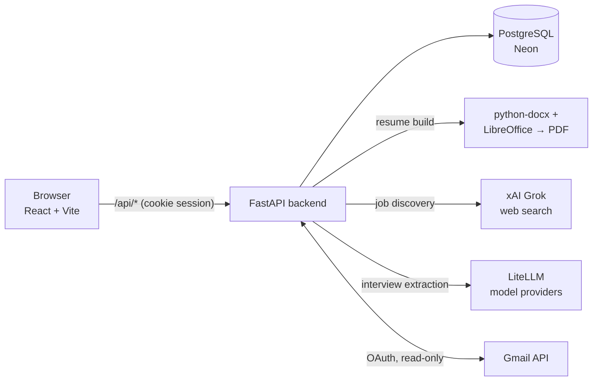
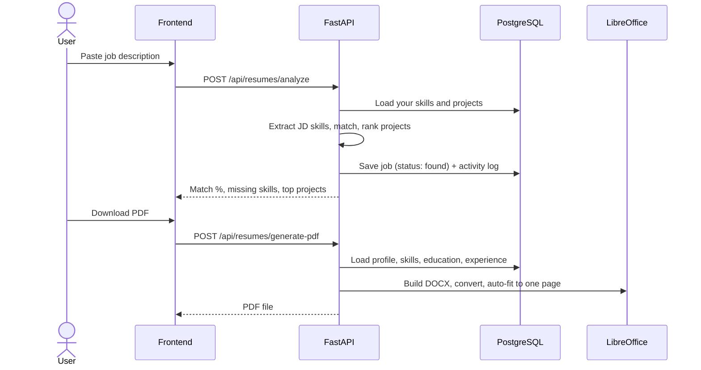
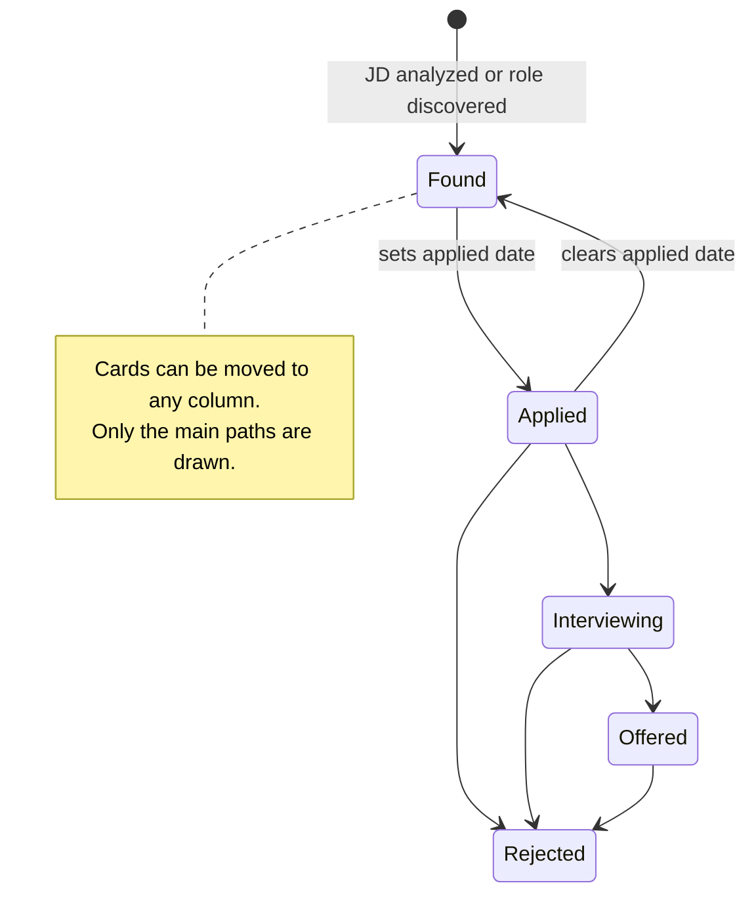

# JobOS

An AI-assisted job-search workspace for international students in the US (F-1 / OPT). Paste a job description, see how it matches your profile, get a one-page tailored resume PDF, discover open roles, and track applications and interviews in one place.

## Features

- **Analyze JD** — extracts skills from a job description, matches them against your profile, and ranks your projects by relevance.
- **Tailored resume** — builds a one-page PDF from *your* profile (education, skills, experience, projects).
- **Discover Jobs** — live web search (xAI Grok) for internship and new-grad postings that mention F-1/OPT. Sponsorship labels are a research aid, not legal or immigration advice.
- **Applications** — kanban board (Found → Applied → Interviewing → Offered → Rejected) with drag-and-drop and a keyboard-friendly status menu.
- **Interviews** — log interviews manually or detect them from Gmail (read-only OAuth).
- **Dashboard** — KPIs, pipeline, activity streak and trend, and the skills your target jobs ask for versus what's on your profile.
- **Profile and onboarding** — education, skills, projects, experience and job preferences.

Not built yet: outreach templates, billing/plans, and account security actions (session revocation, data export, account deletion). Those pages exist in the sidebar and say so.

## Stack

| Layer | Tech |
|---|---|
| Frontend | React 19, TypeScript, Vite, Tailwind CSS 4, lucide-react |
| Backend | FastAPI, SQLAlchemy (async), asyncpg |
| Database | PostgreSQL (Neon in production), plain SQL migrations |
| Auth | bcrypt passwords, JWT in an HTTP-only cookie |
| AI | LiteLLM for extraction; xAI Responses API for job discovery |
| Resumes | python-docx → LibreOffice → PDF (auto-fit to one page) |

## How it fits together



### Analyze a JD and generate a resume



### Application statuses



## Repository layout

```
backend/
  main.py              app setup, resume endpoints
  api/routes/          auth, jobs, profile, interviews, gmail
  services/            db access, resume generator, Gmail, discovery
  utils/               skill extraction/matching, project & experience scoring
  db/migrations/       001_initial … 003_onboarding_profile (SQL)
  tests/               pytest suite (runs against a real database)
frontend/
  src/pages/           one file per screen
  src/components/      Sidebar, ui primitives, charts, toast, modal
  src/index.css        design tokens (Tailwind @theme)
render.yaml            Render blueprint (backend + static frontend)
docker-compose.yml     local Postgres + backend
DEPLOY.md              Render + Neon deployment walkthrough
```

## Run locally

**Prerequisites:** Python 3.11, Node 20+, PostgreSQL with pgvector (or `docker compose up db`), and LibreOffice for PDF export.

```bash
# Database (one option)
docker compose up -d db          # applies backend/db/migrations on first start

# Backend
cd backend
python -m venv ../venv && source ../venv/bin/activate
pip install -r requirements.txt
cp .env.example .env             # then fill in the values below
python -m db.seed                # optional demo data
uvicorn main:app --reload        # http://localhost:8000

# Frontend
cd frontend
npm install
npm run dev                      # http://localhost:5173
```

### Environment (backend/.env)

| Variable | Purpose |
|---|---|
| `DATABASE_URL` | Postgres connection string (`postgres://` or `postgresql://` both work) |
| `SECRET_KEY` | Signs session tokens — set a long random value outside development |
| `CORS_ORIGINS` | Comma-separated allowed frontend origins |
| `XAI_API_KEY`, `XAI_MODEL` | Job discovery |
| `GROQ_API_KEY`, `GEMINI_API_KEY`, `OLLAMA_*` | Model providers used through LiteLLM |
| `GOOGLE_CLIENT_ID`, `GOOGLE_CLIENT_SECRET`, `GOOGLE_REDIRECT_URI`, `FRONTEND_URL` | Gmail OAuth (setup in DEPLOY.md) |

`.env.example` also lists `REDIS_URL` and `AWS_*` entries that the code does not currently use.

> Tests run against the database in `DATABASE_URL` and create their own test user. Point them at a throwaway database, not production.

## Tests and checks

```bash
cd backend && python -m pytest -q
cd frontend && npx tsc -b && npx oxlint && npm run build
```

CI runs both (`.github/workflows/ci.yml`).

## Deployment

Render (Docker backend + static frontend) with Neon Postgres. See [DEPLOY.md](DEPLOY.md).

## Privacy notes

- Pasted job descriptions are saved to your account and processed by the configured AI providers; avoid pasting personal information you don't need to.
- Visa status is optional and is only used inside your own account.
- Generated resumes are written to temporary server storage and are not kept long-term.
